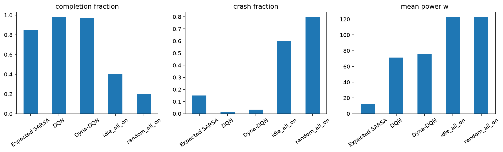

# MORL4AVSO

Reinforcement learning for joint **driving and sensor activation** in a HighwayEnv-based simulator. The project compares Expected SARSA, DQN, and Dyna-DQN while measuring route completion, crashes, completion time, and sensing energy.

The current implementation uses a **weighted scalar reward** combining several objectives. Explicit Pareto-based multi-objective learning is future work. Sensors are simplified object-level models with uncalibrated assumptions, rather than physical camera images or radar waveforms.

## Start here

- [Algorithm comparison and analysis](docs/algorithm_comparison_report.md)
- [Executed 1,000-episode notebook and training curves](experiments/sensor_dqn_long_training.ipynb)
- [Saved runs index](runs/README.md) and [data catalog](data/README.md)
- [Environment design and observation contract](environments/README.md)
- [Organization and provenance](docs/organization.md)

## Repository layout

```text
MORL4AVSO/
├── algorithms/          # Expected SARSA, DQN, Dyna-DQN, shared feature encoder
├── environments/        # Simulator, sensors, configuration, environment tests
├── experiments/         # Executed notebooks, training/evaluation/replay helpers, tests
├── basic/               # Original HighwayEnv and Q-learning learning tutorial
├── runs/
│   ├── comparisons/     # Short/long DQN comparisons, frozen-model evaluations, replays
│   ├── training/        # Earlier SARSA route experiments and checkpoint
│   ├── sensor_studies/  # Realism, contribution/range, and cut-in timing studies
│   ├── environment/     # Fixed-policy environment diagnostics
│   └── tutorial/        # Tabular Q-learning results
├── data/                # Searchable run/data catalogs and migration checksums
├── docs/                # Reports, proposal, milestone documents, project notes
└── .github/workflows/   # Automated tests
```

Each saved run keeps its models, configuration, CSVs, figures, metadata, and replays together. Recorded run IDs and numerical results are preserved. Historical runs are included in this repository; caches, local environments, and temporary files are excluded.

## Setup

Run commands from the `MORL4AVSO` directory. The local environment used for the latest runs was Python 3.14; earlier metadata also records Python 3.13.

```bash
python3.14 -m venv .venv
source .venv/bin/activate
python -m pip install -r requirements-dqn.txt
python -m jupyterlab
```

`requirements-dqn.txt` includes PyTorch and the shared pinned dependencies. For the original SARSA-only workflow, install `requirements.txt` instead. Choose the new `.venv` interpreter in your editor; the old project's virtual environment is not bundled.

## Experiments

| Notebook | Purpose |
| --- | --- |
| [Environment inspection](experiments/sensor_environment_initial_test.ipynb) | Inspect sensing, weather, delayed measurements, and maps |
| [Expected SARSA](experiments/sensor_agent_experiment.ipynb) | Initial adaptive and always-on driving/sensing comparison |
| [Time-to-completion](experiments/sensor_time_completion_experiment.ipynb) | SARSA on a 300 m route with a 16 s deadline |
| [Earlier long-route SARSA](experiments/sensor_time_completion_120s_200episodes.ipynb) | 200 training episodes on 2,250 m / 120 s |
| [DQN introduction](experiments/sensor_dqn_experiment.ipynb) | Simple explanations and a 60-episode three-agent comparison |
| [Longer DQN training](experiments/sensor_dqn_long_training.ipynb) | 1,000 episodes per agent on 300 m / 16 s |
| [Sensor realism](experiments/sensor_realism_validation_study.ipynb) | Baseline implementation checks and calibration register |
| [Sensor contribution](experiments/sensor_contribution_sensitivity_study.ipynb) | Modality ablations and optical range sensitivity |
| [Cut-in timing](experiments/camera_cutin_timing_study.ipynb) | Controlled RGB/event timing diagnostics |

Executed notebook outputs are retained. Opening a notebook does not retrain models; running all training cells can start an expensive fresh run. For loading a completed parallel-training run in the long-training notebook, launch Jupyter with:

```bash
FINAL_PROJECT_DQN_RUN_DIR=runs/comparisons/dqn_long_training_20261112_170403_004536 python -m jupyterlab
```

## Recorded results

All three learned policies below used one training seed and 1,000 episodes on **300 m / 16 s**. Evaluation used 20 held-out traffic seeds in each of clear, rain, and fog: 60 trials per policy, with no exploration or learning.

| Agent | Successful finishes | Crashes | Successful finish time | Mean sensing power |
| --- | --- | --- | --- | --- |
| Expected SARSA | 51/60 | 9/60 | 14.31 s | 12.07 W |
| DQN | 59/60 | 1/60 | 15.00 s | 71.42 W |
| Dyna-DQN | 58/60 | 2/60 | 14.76 s | 75.43 W |

[Training curves PNG](runs/comparisons/dqn_long_training_20261112_170403_004536/training_curves.png)



SARSA used much less sensing power; DQN completed more trips. Successful-trip times exclude failures and compare different subsets. Energy figures cover simulated sensing, not training electricity. One training seed and reused traffic seeds across weather limit generalization claims.

The **same frozen policies** were later evaluated on **2,250 m / 120 s**, without retraining:

| Agent | Successful finishes | Crashes |
| --- | --- | --- |
| Expected SARSA | 11/60 | 49/60 |
| DQN | 57/60 | 3/60 |
| Dyna-DQN | 28/60 | 32/60 |

See the [short-task report](runs/comparisons/dqn_long_training_20261112_170403_004536/study_report.md) and [120-second transfer report](runs/comparisons/dqn_long_training_20261112_170403_004536/evaluation_120s_2250m_20261112_193414_051178/study_report.md). These 120-second results are distinct from the earlier SARSA experiment that actually trained on the longer route.

## Replays

- [300 m matched viewer](runs/comparisons/dqn_long_training_20261112_170403_004536/replays_clear_seed100000_20261112_191411_099079/replay.html)
- [2,250 m matched viewer](runs/comparisons/dqn_long_training_20261112_170403_004536/replays_120s_2250m_clear_seed100000_20261112_193307_152187/replay.html)

Download/clone the repository and open `replay.html` in a browser for playback controls. GitHub's file view displays HTML source. Individual GIFs and action CSVs sit beside each viewer. Frames are captured at 2 Hz; episodes end on crash, off-road, completion, or deadline.

Generate new replays or repeat the frozen-model evaluation from the repository root:

```bash
python -m experiments.replay_agents --seed 100000 --weather clear
python -m experiments.replay_agents --duration 120 --route-distance 2250 --seed 100000 --weather clear
python -m experiments.evaluate_saved_agents --duration 120 --route-distance 2250
```

The default model source is the saved 1,000-episode comparison in `runs/comparisons/`. New exports create separate timestamped folders.

## Algorithms and reward

All agents select among five driving actions and four sensing modes using epsilon-greedy exploration. They share observation-derived features and the same environment reward. SARSA uses linear values; DQN adds a neural network, replay, and target network; Dyna-DQN adds learned one-step outcomes for extra Q updates during training. At evaluation, Dyna-DQN acts through its Q network without model-based planning.

The finite-route reward includes +0.02/m progress, −0.1/s time, +10 safe completion, up to +5 early completion, −10 failure, −0.001/J sensing energy, and an uncertainty penalty. Collisions incur an additional −10; the stock speed bonus is disabled. The 120-second transfer test retains these coefficients while changing route/deadline normalization and exposure.

See the [algorithm walkthrough](algorithms/README.md) for implementation details. Saved policy files support evaluation; they do not contain complete optimizer/replay state for exact training resumption.

## Tests and GitHub

```bash
python -m unittest discover -s environments/tests -v
python -m unittest discover -s experiments/tests -v
```

A GitHub Actions workflow runs these suites on pushes and pull requests. Local publishing instructions are in [docs/github.md](docs/github.md). The requested remote is [the project GitHub repository](https://github.com/Theoceanisfull/Multi-Objective-Reinforcement-Learning-for-Autonomous-Driving-and-Adaptive-Sensor-Optimization-). No project license has been selected.
