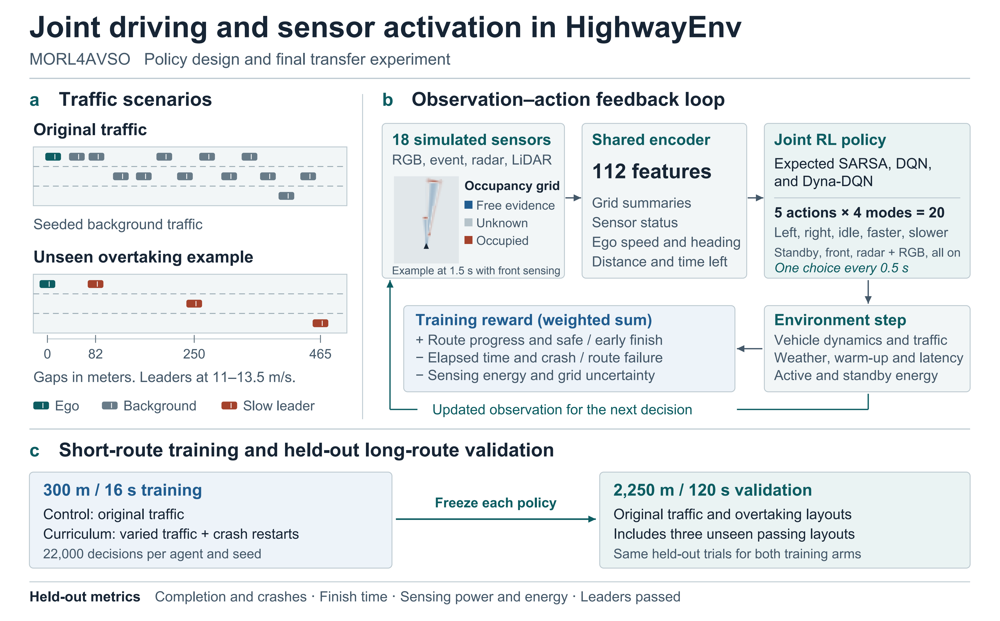

# MORL4AVSO

Reinforcement learning for **joint driving and sensor activation** in HighwayEnv. Expected SARSA, DQN, and Dyna-DQN learn when to activate modeled sensors while trying to finish highway routes safely and on time. The project compares completion, crashes, and sensing energy under original traffic and controlled overtaking.



## Quick start

From a fresh checkout on macOS or Linux (Windows users can run these commands in WSL), use Python 3.14:

```bash
git clone https://github.com/Theoceanisfull/Multi-Objective-Reinforcement-Learning-for-Autonomous-Driving-and-Adaptive-Sensor-Optimization-.git MORL4AVSO
cd MORL4AVSO
python3.14 -m venv .venv
source .venv/bin/activate
python -m pip install -r requirements-dqn.txt
```

The full install includes PyTorch and Jupyter. If you only want the environment and linear Expected SARSA, install `requirements.txt`.

1. **Try the simulator.** This short fixed-policy demo produces a road and occupancy-grid preview.

   ```bash
   SDL_VIDEODRIVER=dummy SDL_AUDIODRIVER=dummy MPLBACKEND=Agg python -m environments.demo --weather fog --sensing front --steps 10
   ```

   Open `runs/local/environment_demo/preview.png`.

2. **Review the completed experiments.** Start Jupyter with `python -m jupyterlab`, open [Analyze recorded route experiments](experiments/analyze_route_results.ipynb), select the Python kernel from `.venv`, and use **Run All**. It reads bundled CSVs and exports plots to `runs/local/plots/` without training.

3. **Train or reproduce a study.** Use the [experiment guide](experiments/README.md) to pick a notebook or command. Training notebooks display recorded results by default. Turn on `RUN_TRAINING` to retrain.

## Main experiments

| Task | Where to start |
| --- | --- |
| Inspect sensing, weather, and measurement aging | [Environment notebook](experiments/sensor_environment_initial_test.ipynb) |
| Compare the three agents on the 300 m / 16 s task | [Short-route training notebook](experiments/sensor_dqn_long_training.ipynb) |
| Train Expected SARSA on the 2,250 m / 120 s task | [Long-route SARSA notebook](experiments/sensor_time_completion_120s_1000episodes.ipynb) |
| Train DQN and Dyna-DQN on the same long route | [Long-route DQN notebook](experiments/sensor_dqn_time_completion_120s_2250m_1000episodes.ipynb) |
| Compare original traffic and controlled slow leaders | [Overtaking notebook](experiments/sensor_overtaking_120s_2250m_1000episodes.ipynb) |
| Evaluate transfer and diagnose all-standby failures | [Three-stage study program](experiments/compare_route_stages.py) |
| Compare varied short-route training and crash restarts against original training | [Curriculum study program](experiments/short_route_curriculum.py) |

The last study trains on 300 m routes and evaluates frozen policies on 2,250 m routes. Both training groups use 22,000 simulator decisions per policy and training seed. A crash ends the episode. In the varied-traffic arm, the next episode starts in a different feasible passing scenario.

```bash
python -m experiments.short_route_curriculum --output runs/local/short_route_curriculum --workers 3
```

Use a new output directory on each run. The default protocol trains three algorithms in two arms across three seeds, then evaluates each saved policy.

## Key results

On the original 2,250 m route, adaptive Expected SARSA and its learned all-on baseline both finished **12/12** matched clear, rain, and fog trials without crashing. Mean modeled sensing power was **89.19 W** with adaptive sensing and **123.00 W** with all sensors on, a **27.5% reduction**. [Baseline results](runs/training/time_completion_120s_1000ep_20261121_204241_241658/summary.csv)

In a separate test, the short-route curriculum improved transfer to unseen overtaking layouts. The arrows show the number of finishes under **original training → varied traffic with crash restarts**, out of 54 trials per condition across three training seeds.

| Policy | Original long-route traffic | Unseen long-route overtaking |
| --- | ---: | ---: |
| Expected SARSA | 29 → 29 | 0 → 27 |
| DQN | 14 → 2 | 4 → 26 |
| Dyna-DQN | 16 → 11 | 12 → 30 |

[Curriculum results](runs/comparisons/short_route_varied_restart_20261122_125122_162138/summary.csv) · [Per-seed results](runs/comparisons/short_route_varied_restart_20261122_125122_162138/summary_by_training_seed.csv) · [Watch Dyna-DQN pass three slow vehicles on an unseen layout](runs/comparisons/short_route_varied_restart_20261122_125122_162138/replays/dyna_dqn_unseen_wide_gaps_clear_seed300000_realtime.gif)

The control loop uses 112 features in fixed-route tasks and selects one of 20 joint actions every 0.5 seconds. A weighted reward combines driving, timing, energy, and uncertainty. The sensors are uncalibrated object-level models, and the power figures describe modeled sensing during simulation.

## Repository layout and tests

| Path | Contents |
| --- | --- |
| [`algorithms/`](algorithms/) | Linear, neural, and spiking policies |
| [`environments/`](environments/) | Simulator, sensing, weather, and observation model |
| [`experiments/`](experiments/) | Notebooks, training, evaluation, and replay programs |
| [`runs/`](runs/) | Recorded results, configurations, portable model weights, and selected replays |
| [`data/`](data/) | Run catalog and file checksums |
| `runs/local/` | Generated results and local training state, ignored by Git |

```bash
SDL_VIDEODRIVER=dummy SDL_AUDIODRIVER=dummy MPLBACKEND=Agg python -m unittest discover -s environments/tests -v
SDL_VIDEODRIVER=dummy SDL_AUDIODRIVER=dummy MPLBACKEND=Agg python -m unittest discover -s experiments/tests -v
```

GitHub Actions runs both suites on pushes and pull requests. Rebuild the saved-run index with `python scripts/catalog_runs.py`.
